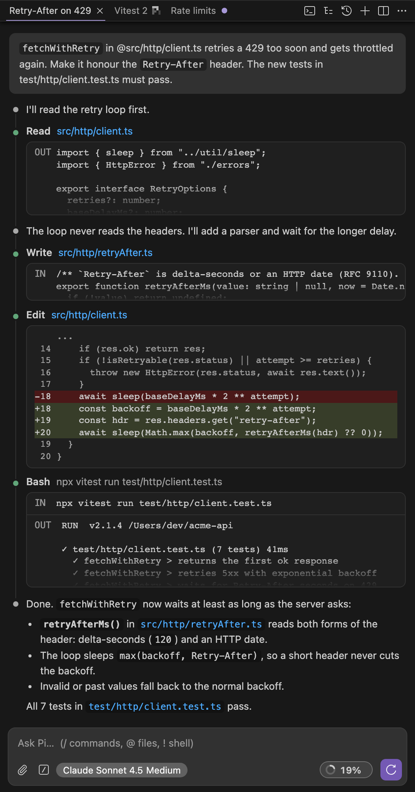
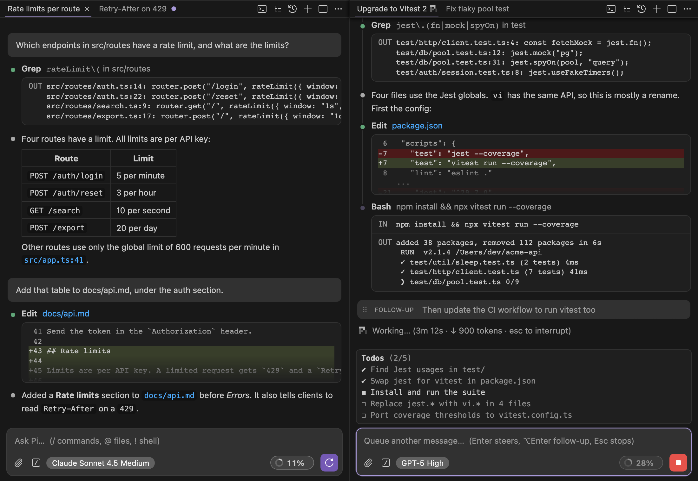
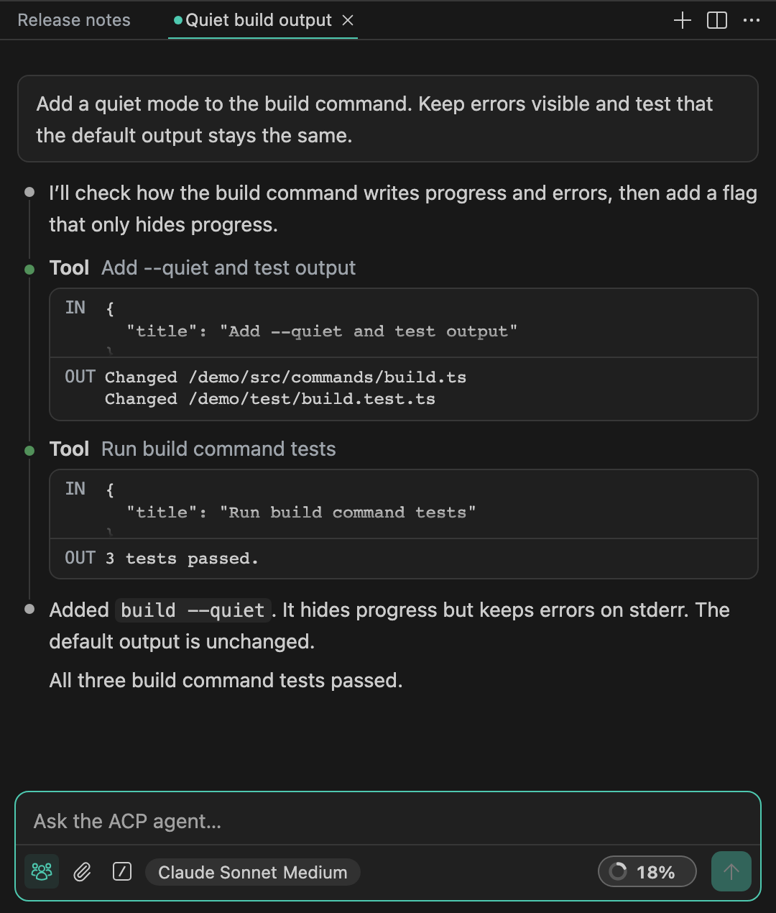
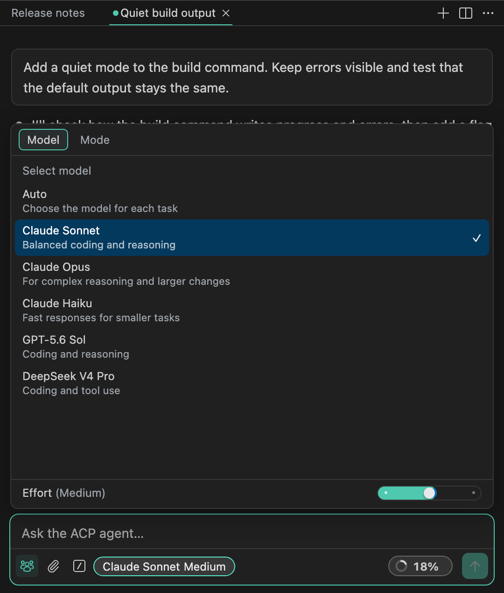

# PiMux for VS Code

Use the [Pi coding agent](https://pi.dev) and ACP agents (Kiro, Antigravity, and others) in the VS Code sidebar. Sessions can keep running when VS Code closes or Remote-SSH disconnects.

<p align="center"></p>

## Requirements

- VS Code 1.90 or later.
- For Pi chats: `pi` installed (`npm i -g @earendil-works/pi-coding-agent`) and set up. Run `pi` once and log in.
- For ACP chats: an ACP agent installed and signed in, for example `kiro-cli` or `agy`.

The extension starts your installed `pi` in RPC mode. Your Pi settings, models, auth, extensions, skills, prompt templates, and sessions apply without changes.

## Features

### Chat
- Replies, thinking, and tool calls stream in as a timeline. Tool cards show input, output, and diffs.
- While Pi works: <kbd>Enter</kbd> steers, <kbd>⌥ Enter</kbd> queues a follow-up, <kbd>Esc</kbd> stops.
- `/` for commands, `@` for file paths, `!cmd` for shell commands. Paste, drop, or attach files and images.
- <kbd>⌘F</kbd> (<kbd>Ctrl+F</kbd>) finds text in the chat.
- The context pill shows how full the context is. Click it to compact.
- The model menu lists your enabled models and has the effort slider.
- <kbd>⌘⌥L</kbd> adds the editor selection to the chat. Click a file path in the chat to open it.

### Sessions
- Resume, fork, rename, or archive sessions from a searchable list.
- Sessions run in parallel. A busy session continues in the background and notifies you when it finishes.
- Each open session has a tab in the sidebar header. Drag tabs to reorder them. Tabs come back when VS Code restarts.
- `/tree` moves between branches of a session.
- `pi.autoTitle` names new sessions from the first prompt. `/title` does it on request.
- *View* opens a session file read-only, for example to follow a subagent.
- *Continue Session in Terminal* moves the session into the pi TUI and back.

### Tiles and tabs



- Split the sidebar into up to 4 chats. Each tile has its own session tabs.
- Drag a tab into the chat to open it in a new tile. Drag a tile onto another tile to merge them.
- *Open in New Tab* opens a chat in the editor area.

### Pi extensions
- Extension commands, dialogs, notifications, status text, and widgets work in the chat.
- `/btw` and the other pi-btw commands open a side panel. See [integrations/pi-btw](integrations/pi-btw/README.md).

## ACP chats

<p align="center">
  
  
</p>

Add your agents as profiles in VS Code settings:

```json
"pi.acp.profiles": {
  "Kiro": { "command": "kiro-cli", "args": ["acp", "--agent-engine", "v3"], "accentColor": "#8B5CF6" },
  "Antigravity": { "command": "agy", "args": ["acp"] }
}
```

- Click the logo at the left of the composer toolbar and choose a profile. Each chat keeps its agent, so you can run several agents side by side.
- The profile name shows next to the logo. `accentColor` (optional) colors that profile's chat.
- **Pi: New ACP Chat** opens an ACP chat in an editor tab.
- With no profiles, the first ACP chat asks for an executable and its arguments.
- ACP chats support streamed replies, tool status, permission prompts, and Stop. Images, model and effort settings, slash commands, context usage, and compaction work when the agent supports them.
- ACP chats need a trusted workspace. For Remote-SSH, install the agent on the remote host.
- ACP chats do not use Pi's session files or extensions.

## Keep sessions alive

Set `pi.keepSessionsAlive` to `always` or `remote`. Sessions then run in a daemon apart from VS Code.

- Pi tabs restore as before. A busy Pi session finishes its run without a window.
- Click **Agent Sessions** in the status bar to reconnect to a detached session or to stop it.
- An ACP chat comes back with its transcript, its running turn, and its pending permission requests. ACP permissions always wait for your answer.
- `pi.detachedDialogs` sets what a detached Pi session does with a question: wait, cancel it, or accept the recommended option.

## pimuxd (preview)

`pimuxd` is the native session daemon, for macOS arm64 and Linux x86-64. It is one binary and needs neither Node.js nor VS Code. Start sessions over SSH, then attach from VS Code.

```sh
pimuxd start                                        # or `serve` for the foreground
pimuxd acp open -- kiro-cli acp --agent-engine v3   # start an agent in this directory
pimuxd sessions
pimuxd logs SESSION_ID
pimuxd stop SESSION_ID                              # keeps the saved chat
pimuxd forget SESSION_ID                            # deletes the saved chat
pimuxd shutdown
```

- To chat with a session, open the same directory in VS Code and select it in **Agent Sessions**.
- VS Code attaches to a daemon that is already running. Set `pi.experimental.nativeDaemon` to make VS Code start the bundled `pimuxd` when no daemon runs. Without it, VS Code starts the older Node.js daemon.
- `pimuxd` saves recent ACP messages on disk. After a crash, the chat comes back and shows where it stopped. It never resends a prompt or an approval.
- One client controls a session. Other clients can only observe it.

## Settings

| Setting | Default | Description |
|---|---|---|
| `pi.path` | `""` | Path to the `pi` executable. |
| `pi.args` | `[]` | More CLI arguments for pi, for example `["--model", "sonnet"]`. |
| `pi.acp.profiles` | `{}` | Named ACP agents: `command`, `args`, and `accentColor`. |
| `pi.acp.command`, `pi.acp.args` | `""`, `[]` | The ACP agent when no profiles are set. |
| `pi.acp.accentColor` | `""` | Color for ACP chats without a profile color, for example `"#24a487"`. |
| `pi.keepSessionsAlive` | `off` | Run sessions in a daemon: `off`, `remote` (only in remote windows), or `always`. |
| `pi.detachedDialogs` | `wait` | A question from a detached Pi session: `wait`, `deny`, or `acceptRecommended`. |
| `pi.experimental.nativeDaemon` | `false` | Start the bundled `pimuxd` when no daemon runs. |
| `pi.daemonPath` | `""` | Path to `pimuxd` on the extension host. |
| `pi.resumeLastSession` | `true` | Reopen the last session of the workspace. |
| `pi.useLoginShellEnv` | `true` | Load the environment of your login shell (PATH, API keys). |
| `pi.terminalLocation` | `"editor"` | Where terminals open: an editor tab or the terminal panel. |
| `pi.sessionPickerLimit` | `300` | Maximum number of session trees in the session list. |
| `pi.warmTabs` | `3` | Idle tabs per tile that keep their pi process (~200 MB each). |
| `pi.autoTitle` | `false` | Give each new session a short title from its first prompt. |
| `pi.titleModel` | `""` | Model for the titles, as `provider/id`. |
| `pi.continuePrompt` | `"Continue as you left off."` | The prompt that the Continue button sends. |
| `pi.workarounds` | `{}` | Turn off a workaround, for example `{ "child-runs": false }`. |

## Limitations

- The extension handles these pi TUI commands itself: `/new`, `/resume`, `/model`, `/thinking`, `/compact`, `/name`, `/title`, `/fork`, `/clone`, `/session`, `/copy`, `/export`, and `/restart`.
- TUI-only extension APIs do not work in RPC mode: `ctx.ui.custom()`, custom editors, footers, headers, and `onTerminalInput`. For these, open the session in the terminal.
- A host that stops all user processes at logout also stops the daemon. Run `loginctl enable-linger` on such a host.

## Development

```bash
npm install
npm run build            # or: npm run watch
npm run typecheck
npm run package:native   # VSIX with pimuxd, and dist/pimuxd-<target>.tar.gz
```

Press <kbd>F5</kbd> ("Run Extension") to debug. Logs from pi's stderr go to the **Pi** output channel.

See [docs/features.md](docs/features.md) for the full feature list and [docs/notes.md](docs/notes.md) for implementation details.
