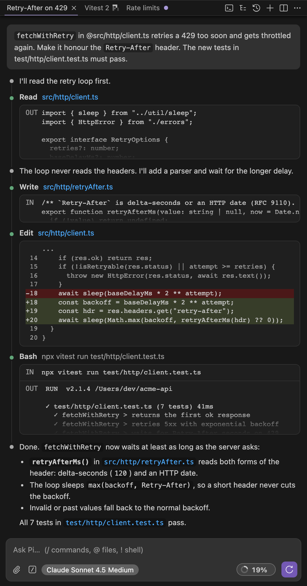
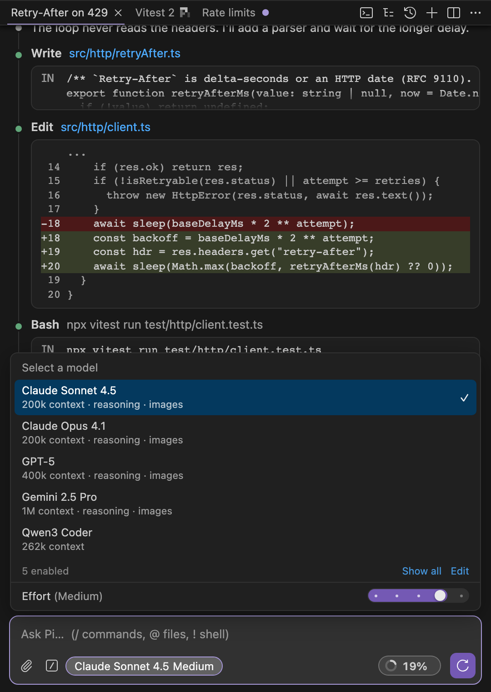
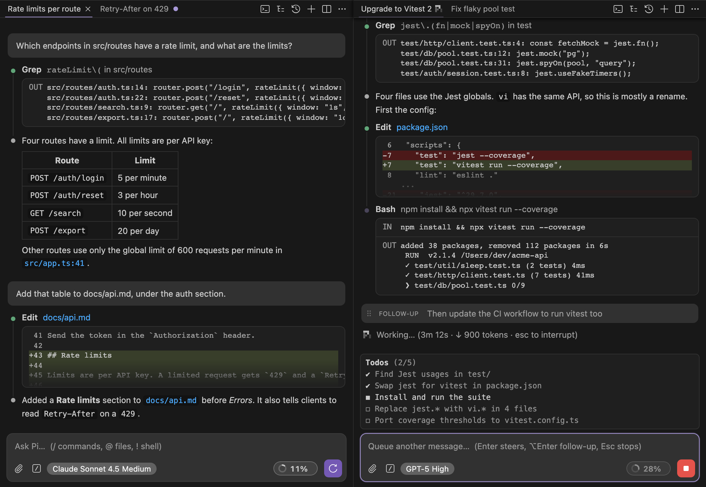

# Pi for VS Code

Use the [Pi coding agent](https://pi.dev) in the VS Code sidebar, in a UI like Claude Code for VS Code.

The extension starts your installed `pi` in RPC mode (`pi --mode rpc`) in the workspace folder. Your Pi setup applies without changes: settings, models, auth, **extensions**, skills, prompt templates, MCP adapters, and sessions.

<p align="center"></p>

## Features

### Chat
- Replies, thinking and tool calls stream in as a timeline. Tool cards show input and output, and edits show a diff.
- Hover over a message or tool call to see its time. Tool calls also show how long they ran.
- Tool calls that a tool makes (for example from codemode or a subagent tool) show under that tool's card.
- Cards of extension tools also show the tool's `details` (DATA), including partial results while the tool runs.
- Markdown renders in replies and in your sent prompts. It is also styled live as you type.
- When the composer is empty and the last message is from the model, the send button changes to Continue. It sends `pi.continuePrompt`.
- While Pi works: <kbd>Enter</kbd> steers, <kbd>⌥ Enter</kbd> queues a follow-up, <kbd>Esc</kbd> stops.
- Queued messages show at the end of the chat. Drag to reorder them, or remove or send one now.
- `/` for commands, `@` for file paths, `!cmd` for shell commands. Paste, drop or attach files. Images go to the model as images; other files go as `@path` references.
- The context pill shows how full the context is. Click it to compact.
- A π with a count shows next to the context pill while sessions run inside the chat (for example subagents or workflow agents). Click it to see them.

### Models
- The model menu lists the models in Pi's `enabledModels`, or all models if the setting is empty.
- The effort (thinking level) slider is at the bottom of the same menu.



### Sessions
- Resume or fork from a searchable list. Archive a session to hide it from the list.
- Rename the current session: double-click its name in the sidebar header, or use *Rename Session…* (in the sidebar's *More Actions* menu, the tab's overflow menu, or the command palette). `/name <name>` also works.
- Rename any session in the session list with the pencil button or F2.
- Short session titles: turn on `pi.autoTitle`, and a small model names each new session from its first prompt (for example `Fix flaky tab titles`).
- Give a session that you have open a new title from its prompts: *Generate Session Title* (in the same menus as *Rename Session…*) or `/title`. It works without `pi.autoTitle` and replaces the name.
- Forks and sessions that extensions start (for example subagents) are nested under the session they came from. They are collapsed until you expand them.
- Sessions run in parallel. If you start a new session or open another one while Pi works, the busy session continues in the background. It shows below the current session in the session list, and a notification tells you when it finishes or needs an answer.
- Sessions can keep working without VS Code (`pi.keepSessionsAlive`). A session daemon then runs the pi processes. If the window closes or a Remote-SSH connection drops, a session that works continues on the host. When you open the folder again, the session comes back with its tab. A notification tells you which sessions finished in the meantime.
- The status bar has one **Pi** item. It spins while a session works, and shows the number of sessions that run without a window ("detached"). Click it to list the sessions, show one or stop a detached one, and to change the two daemon settings.
- `pi.detachedDialogs` sets what happens when a detached session asks a question: it waits for you (default), the question is cancelled, or the recommended option is accepted.
- The session list shows the current session first, then the sessions that run in the background, then the other sessions by date. Nested sessions stay under their parent session in each group.
- *View* (the eye button in the session list, or *Pi: View Session File*) opens a session read-only in a new tab. It starts no pi process and shows new messages as pi writes them. Use it to follow a session that an extension runs, for example a subagent.
- `/tree` moves between branches of a session. It can summarize the branch you leave and label entries.
- `/tree` can also start a new session from an entry ("New", Ctrl+Enter). The current session does not change.
- The last session reopens automatically. *Open in New Tab* starts another chat.
- The sidebar header shows a tab for each session that is open in the sidebar. + starts a session in a new tab, and a session that you open from the session list gets a tab too. A working tab shows the π spinner; a tab that finished in the background shows a dot. Close a tab with its × or a middle click. The tabs come back when VS Code starts again.
- Drag a tab to reorder it. A tab is as wide as its title and gets narrower only when the tabs do not fit.
- Tabs that you used last switch at once: they keep their pi process (`pi.warmTabs`, 3 by default). + also shows a new session at once. Its tab stays when you go back to another tab, also before you send a message.
- When VS Code starts, each tab shows its session from the session file at once, while pi starts.
- A session is open in one chat only. If you open a session that another chat has open, that chat comes to the front. The session list shows such sessions as "other chat".

### Tiles



- Split the sidebar into up to 4 chats with the split button in the header. Each tile has its own session tabs and runs its own sessions. The new tile shows a new session at once: it takes the tile's spare process.
- Tiles stack top to bottom, or sit side by side when the sidebar is wide enough. All tiles have the same size after a split or a close. Drag the line between two tiles to resize them; double-click it to make all tiles the same size again.
- Drag a tab out of its tabs into the chat to open it in a new tile, on the half where you drop it. Drag it to another tile's tabs or middle to move it there, or to that tile's edge for a new tile next to it. The label at the pointer says what the drop does.
- Drag a tile by the empty part of its header: to the middle of another tile to merge the two into tabs, or to its edge to move the tile.
- Close a tile with *Close Tile* in its More Actions menu, or by closing its last tab, or by dragging its last tab away.
- A tab that is still loading can be closed or moved. A close stops the load; a move takes the loading session along.
- The tiles, their tabs and their sizes come back when VS Code starts again.

### Chat tabs
- *Open in New Tab* opens a chat in the editor area. In the session list, the split button, <kbd>⌥</kbd>-click or <kbd>⌥↵</kbd> opens a session in a new chat tab to the side.
- Chat tabs and their sessions come back after a window reload.
- A chat tab whose session works shows ● before its title. The Pi item in the status bar counts the working sessions in all chats. Click it to go to one.
- Narrow chats use a compact layout.

### Pi extensions
- Extension commands, dialogs, notifications, status text and widgets work in the chat. Minimize a widget to its first line with its chevron button.
- The core uses only pi's RPC protocol. Support for one pi extension is a separate integration in `integrations/`.
- **pi-btw:** `/btw` and the other pi-btw commands open a side panel next to the chat. The panel shows the side thread, restores it from the session, and has Inject, Summarize and Clear buttons. A toggle button shows when the session loads pi-btw. See [integrations/pi-btw](integrations/pi-btw/README.md).

### Terminal
- *Pi: Open in Terminal* starts a new pi TUI session.
- *Continue Session in Terminal* moves the current session into the TUI. The chat pauses and picks the session back up when you close the terminal.

### Editor
- <kbd>⌘⌥L</kbd> adds the selection to the chat. The Explorer context menu adds a file.
- Click a file path in the chat to open it.

## Notes

- **Nested sessions** use the `parentSession` field of the session header, the same as pi's `/resume`. A session whose parent is not in the list shows at the top level.
- **Times** come from the `timestamp` of each message. pi does not save when a tool starts, so after a reload a tool call shows when it finished, and no run time.
- **Nested tool calls** come from `parentToolCallId` on `tool_execution_*` events. After a reload, pi keeps only a record of them (`nestedCalls`: names, arguments, status, errors), so their outputs are not shown.
- **The session viewer** reads the session file and checks it for changes every second. It shows the branch of the last entry in the file.
- **Renaming from the session list** goes through the pi process that has the session open, in any chat. If no process has it open, the extension adds the name to the session file, the same as a rename in the pi TUI's `/resume` list. A session that is open in the terminal or runs as a subagent can't be renamed until it is free.
- **Archived sessions** stay on disk. Only the list in VS Code hides them, so the pi TUI can still resume them.
- **`/tree`** needs a command that RPC mode does not have. The extension adds it by loading a small bridge extension into pi (`dist/pi-bridge.mjs`).
- **Queue edits** take the whole queue out of pi and queue it again, because RPC mode can only add to the queue or clear it. Images in queued messages are not kept. **Send now** stops the run and sends the message as the next run.
- **Factory widgets** (for example todo lists and agent bars) are dropped by RPC mode. A workaround renders them to text lines at the width of the chat view and sends them again when they change (at most 4 times a second).
- **Running child sessions** are not in RPC events. A workaround counts the prompts that run on other agent sessions in the process and reports them, with their session files, in a hidden status. The titles come from the session files. Sessions that an extension keeps only in memory have no title. pi-btw side threads also count while they answer.
- **Tiles** are chats in one webview: `mountChat` (webview/chat.ts) builds each one in its own element. They are not iframes, because VS Code ignores keys from nested frames, so its shortcuts would not work in a tile.
- **Session tabs** keep the pi process of up to `pi.warmTabs` idle tabs per tile. A few seconds after a tab opens, the tile starts processes for the tabs next to it, one at a time. Other idle tabs have no process; opening one switches the tile's process to its file (about a second). A busy tab that you leave keeps its process, the same as a background session. A new session that you leave before its first message has no file, so its tab closes.
- **Kept views:** the chat keeps the transcripts of the last 8 tabs that you left in the page (hidden). A click on such a tab shows it at once, at the same scroll position. pi's snapshot follows; if it has the same messages, nothing is drawn again. A session that works is drawn again from pi when you come back.
- **Session titles** (`pi.autoTitle`) come from the bridge extension. It sends the first prompt (4000 characters at most) to the title model and saves the answer as the session name, so the pi TUI shows it too. It does not replace a name that the session has. The setting applies to pi processes that start after you change it.
- **A spare process** with a new, empty session waits in each tile while `pi.warmTabs` is more than 0, so + needs no wait. If you close the tab of a new session before its first message, its process becomes the spare again.
- **New sessions without a message** have no file: pi writes it with the first message. Their tab keeps the session id and opens it again with `--session-id`.
- **Startup:** the chat starts pi as soon as the sidebar opens, not when the webview is ready, and the login shell environment is read when the extension activates. Until pi answers, the chat shows the session from its file (the same reader as the session viewer). Tabs get their own processes only after all chats have started.
- **Moving a tab** to another tile moves its pi process too, so nothing restarts and only one process has the file. A session that works moves with its turn, open dialogs, queued messages, widgets and the running child sessions; the other tile shows the turn from where it is. The same goes for merging tiles.
- **The session daemon** (`src/daemon/piDaemon.ts`, `dist/pi-daemon.js`) is one process per user. The extension starts it on first use, apart from the extension host, and talks to it on a unix socket in `~/.pi/vscode-daemon/` (a named pipe on Windows). Each chat connection is the RPC stream of one pi process. When a connection closes, a session with a run or an open question continues; an idle one stops. A detached session stops 60 seconds after its work ends, and the daemon exits when it has no sessions. A start of a session file that a detached process has open gets that process, with its open questions and its unfinished output. `daemon.log` in the same directory lists what the daemon did, also the questions that it answered. If the daemon cannot start, pi runs as a child process as before.
- **The daemon and logout:** a host that stops all processes of a user at logout (systemd `KillUserProcesses=yes`) also stops the daemon. Run `loginctl enable-linger` on such a host.
- **One chat per session:** a chat that would open a session that another chat has open (for example after a reload) starts a new session. A session that runs in a chat's background stays in that chat.
- **Terminal hand-off** stops the chat's pi process while the terminal has the session, so that two processes never write to the same file.
- **Integrations** add support for one pi extension beyond pi's RPC protocol. Each one is in `integrations/<name>/`, and `integrations/host.ts` and `integrations/web.ts` list them. An integration is active only in sessions that load its pi extension. It can also load a small pi extension of its own (`integrations/<name>/pi.ts`), for example the pi-btw workaround for notes that arrive during a run. See [integrations/README.md](integrations/README.md).
- **Workarounds** fill gaps in pi's RPC mode for every extension, for example factory widgets and running child sessions. Each one is in `workarounds/<name>/` and loads its own small pi extension. The child-runs workaround uses pi internals; if a pi update breaks one, turn it off with `pi.workarounds`. See [workarounds/README.md](workarounds/README.md).

## Built-in slash commands

These commands come from the pi TUI. The extension does them itself, because RPC mode does not have them. `/new`, `/resume`, `/model`, `/thinking`, `/compact [instructions]`, `/name <name>`, `/title`, `/fork`, `/clone`, `/session`, `/copy`, `/export [path]`, `/restart` (restarts pi and reloads extensions).

If an extension registers a command with the same name, the extension command runs.

## Requirements

- `pi` installed (`npm i -g @earendil-works/pi-coding-agent`) and set up (you ran `pi` once and logged in).
- VS Code 1.90 or later.

VS Code apps opened from the Dock often do not get your shell `PATH`. For this reason, the extension reads the environment of your login shell (mise, nvm, Homebrew, and exported API keys) before it starts pi. To turn this off, use `pi.useLoginShellEnv`, or set `pi.path` to the full path of `pi`.

## Settings

| Setting | Default | Description |
|---|---|---|
| `pi.path` | `""` | Path to the `pi` executable. |
| `pi.args` | `[]` | More CLI arguments, for example `["--model", "sonnet"]`. |
| `pi.resumeLastSession` | `true` | Reopen the last session of the workspace. |
| `pi.useLoginShellEnv` | `true` | Load the environment of your login shell. |
| `pi.terminalLocation` | `"editor"` | Where terminals open: as an editor tab or in the terminal panel. |
| `pi.keepSessionsAlive` | `off` | Run sessions in a daemon apart from VS Code, so that they keep working when the window closes or disconnects: `off`, `remote` (only in remote windows) or `always`. |
| `pi.detachedDialogs` | `wait` | A question from a session that no window has: `wait` for you, `deny` (cancel it) or `acceptRecommended` (confirm; select the option marked "(Recommended)", else the first). A question for free text always waits. |
| `pi.warmTabs` | `3` | Idle session tabs per tile that keep their pi process, so that switching to them is quick. Each process uses about 200 MB. |
| `pi.autoTitle` | `false` | Give each new session a short title, written by a small model from the first prompt. |
| `pi.titleModel` | `""` | Model for the titles, as `provider/id`. Empty: a Haiku model of the session's provider, else the session's model. |
| `pi.continuePrompt` | `"Continue as you left off."` | The prompt that the Continue button sends. |
| `pi.workarounds` | `{}` | Turn off a workaround for a gap in RPC mode, for example `{ "child-runs": false }`. All are on by default. |

Extensions can check `process.env.PI_VSCODE === "1"` to know that they run inside VS Code.

## Limitations (from RPC mode)

TUI-only extension APIs do not work in RPC mode. These are `ctx.ui.custom()`, custom editors, footers and headers, and `onTerminalInput`. Commands that open a composer or overlay in the TUI show their notice instead. See Pi's [RPC Extension UI docs](https://pi.dev) for more information. `/tree` works through the bridge extension, and factory widgets through a workaround. Widgets are read-only, but you can minimize them. The pi-subagents integration hides its fleet list (the agent picker below the editor), because its keys do nothing here. The agents widget shows the top-level agents, and the running-sessions count in the composer includes workflow agents. For everything else, open the session in the terminal.

## Development

```bash
npm install
npm run build        # or: npm run watch
npm run typecheck
npm run package      # creates pi-for-vscode-<version>.vsix
code --install-extension pi-for-vscode-0.2.1.vsix
```

To debug, press <kbd>F5</kbd> with `.vscode/launch.json` ("Run Extension"). Logs from pi's stderr go to the **Pi** output channel.
