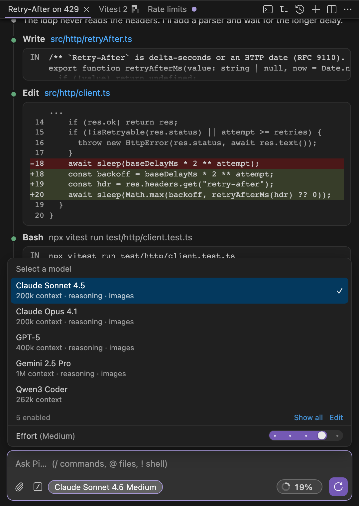
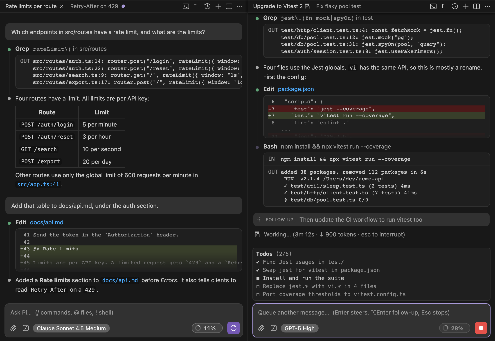

# Features

The full feature list. The [README](../README.md) has the short version.

## Chat
- Replies, thinking and tool calls stream in as a timeline. Tool cards show input and output, and edits show a diff.
- Hover over a message or tool call to see its time. Tool calls also show how long they ran.
- Tool calls that a tool makes (for example from codemode or a subagent tool) show under that tool's card.
- Cards of extension tools also show the tool's `details` (DATA), including partial results while the tool runs.
- Markdown renders in replies and in your sent prompts. It is also styled live as you type.
- When the composer is empty and the last message is from the model, the send button changes to Continue. It sends `pi.continuePrompt`.
- While Pi works: <kbd>Enter</kbd> steers, <kbd>⌥ Enter</kbd> queues a follow-up, <kbd>Esc</kbd> stops.
- Queued messages show at the end of the chat. Drag to reorder them, or remove or send one now.
- `/` for commands, `@` for file paths, `!cmd` for shell commands. Paste, drop or attach files. Images go to the model as images; other files go as `@path` references.
- <kbd>⌘F</kbd> (<kbd>Ctrl+F</kbd>) finds text in the chat. <kbd>Enter</kbd> and <kbd>⇧ Enter</kbd> go to the next and the previous match. A match in collapsed text (thinking, a long prompt, a tool output) opens it. Also in the ⋯ menu and as **Pi: Find in Chat**.
- The context pill shows how full the context is. Click it to compact.
- A π with a count shows next to the context pill while sessions run inside the chat (for example subagents or workflow agents). Click it to see them.

## Models
- The model menu lists the models in Pi's `enabledModels`, or all models if the setting is empty.
- The effort (thinking level) slider is at the bottom of the same menu.

## Sessions
- Resume or fork from a searchable list. Archive a session to hide it from the list.
- Rename the current session: double-click its name in the sidebar header, or use *Rename Session…* (in the sidebar's *More Actions* menu, the tab's overflow menu, or the command palette). `/name <name>` also works.
- Rename any session in the session list with the pencil button or F2.
- Short session titles: turn on `pi.autoTitle`, and a small model names each new session from its first prompt (for example `Fix flaky tab titles`).
- Give a session that you have open a new title from its prompts: *Generate Session Title* (in the same menus as *Rename Session…*) or `/title`. It works without `pi.autoTitle` and replaces the name.
- Forks and sessions that extensions start (for example subagents) are nested under the session they came from. They are collapsed until you expand them.
- Sessions run in parallel. If you start a new session or open another one while Pi works, the busy session continues in the background. It shows below the current session in the session list, and a notification tells you when it finishes or needs an answer.
- The session daemon can keep Pi and ACP sessions running on the host when VS Code closes or Remote-SSH disconnects (`pi.keepSessionsAlive`). Pi tabs restore as before. Reconnect to ACP sessions from **Agent Sessions** in the status bar.
- **Agent Sessions** lists detached sessions. Select one to reconnect, or use its Stop button to end it.
- `pi.detachedDialogs` sets what happens when a detached session asks a question: it waits for you (default), the question is cancelled, or the recommended option is accepted.
- The session list shows the current session first, then the sessions that run in the background, then the other sessions by date. Nested sessions stay under their parent session in each group.
- *View* (the eye button in the session list, or *Pi: View Session File*) opens a session read-only in a new tab. It starts no pi process and shows new messages as pi writes them. Use it to follow a session that an extension runs, for example a subagent.
- `/tree` moves between branches of a session. It can summarize the branch you leave and label entries.
- `/tree` can also start a new session from an entry ("New", Ctrl+Enter). The current session does not change.
- The last session reopens automatically. *Open in New Tab* starts another chat.
- The sidebar header shows a tab for each session that is open in the sidebar. + starts a session in a new tab, and a session that you open from the session list gets a tab too. A working tab shows the π spinner; a tab that finished in the background shows a dot. Close a tab with its × or a middle click. The tabs come back when VS Code starts again.
- Drag a tab to reorder it. A tab is as wide as its title and gets narrower only when the tabs do not fit.
- Tabs that you used last switch at once: they keep their pi process (`pi.warmTabs`, 3 by default). + also shows a new session at once. Its tab stays when you go back to another tab, also before you send a message.
- When VS Code starts, each tab shows its session from the session file at once, while pi starts.
- A session is open in one chat only. If you open a session that another chat has open, that chat comes to the front. The session list shows such sessions as "other chat".

## Tiles

- Split the sidebar into up to 4 chats with the split button in the header. Each tile has its own session tabs and runs its own sessions. The new tile shows a new session at once: it takes the tile's spare process.
- Tiles stack top to bottom, or sit side by side when the sidebar is wide enough. All tiles have the same size after a split or a close. Drag the line between two tiles to resize them; double-click it to make all tiles the same size again.
- Drag a tab out of its tabs into the chat to open it in a new tile, on the half where you drop it. Drag it to another tile's tabs or middle to move it there, or to that tile's edge for a new tile next to it. The label at the pointer says what the drop does.
- Drag a tile by the empty part of its header: to the middle of another tile to merge the two into tabs, or to its edge to move the tile.
- Close a tile with *Close Tile* in its More Actions menu, or by closing its last tab, or by dragging its last tab away.
- A tab that is still loading can be closed or moved. A close stops the load; a move takes the loading session along.
- The tiles, their tabs and their sizes come back when VS Code starts again.

## Chat tabs
- *Open in New Tab* opens a chat in the editor area. In the session list, the split button, <kbd>⌥</kbd>-click or <kbd>⌥↵</kbd> opens a session in a new chat tab to the side.
- Chat tabs and their sessions come back after a window reload.
- A chat tab whose session works shows ● before its title. The Pi item in the status bar counts the working sessions in all chats. Click it to go to one.
- Narrow chats use a compact layout.

## Pi extensions
- Extension commands, dialogs, notifications, status text and widgets work in the chat. Minimize a widget to its first line with its chevron button.
- The core uses only pi's RPC protocol. Support for one pi extension is a separate integration in `integrations/`.
- **pi-btw:** `/btw` and the other pi-btw commands open a side panel next to the chat. The panel shows the side thread, restores it from the session, and has Inject, Summarize and Clear buttons. A toggle button shows when the session loads pi-btw. See [integrations/pi-btw](../integrations/pi-btw/README.md).

## Terminal
- *Pi: Open in Terminal* starts a new pi TUI session.
- *Continue Session in Terminal* moves the current session into the TUI. The chat pauses and picks the session back up when you close the terminal.

## Editor
- <kbd>⌘⌥L</kbd> adds the selection to the chat. The Explorer context menu adds a file.
- Click a file path in the chat to open it.
